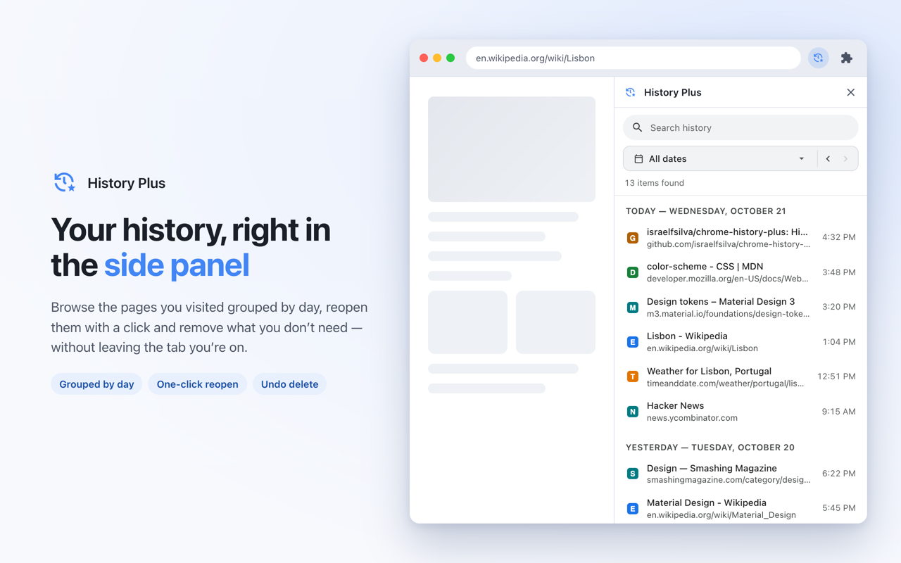
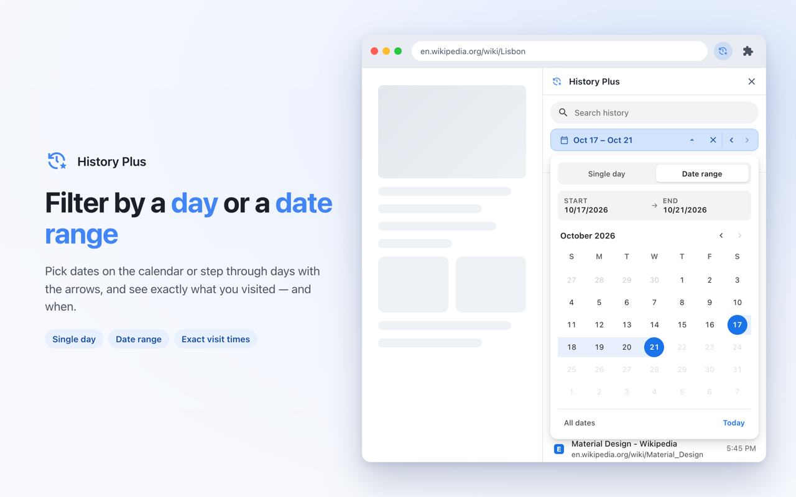
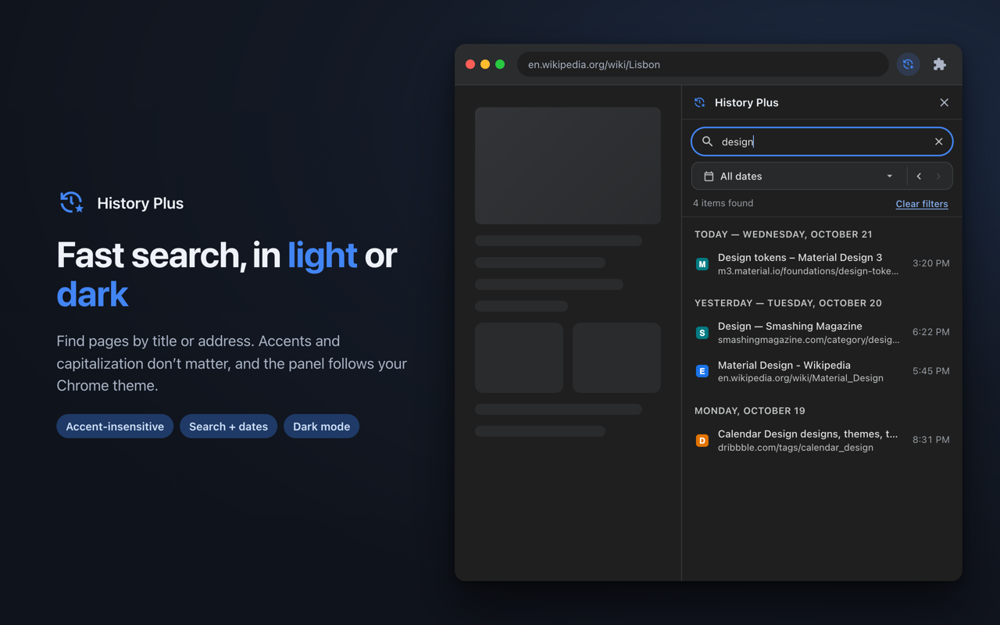

<p align="center">
  
</p>

<h1 align="center">History Plus</h1>

<p align="center">
  Your Chrome browsing history in the side panel, with search and filtering by day or date range.<br>
  <a href="README.pt-BR.md">Leia em português</a>
</p>



## Features

- **History in the side panel**: browse visited pages grouped by day without leaving the current tab.
- **Day or date range filter**: pick a single day or a start–end range on the calendar, or step through days with the arrows. Chrome's built-in history page has no date picker.
- **Exact visit times**: Chrome's history search only reports the latest visit of each URL. History Plus resolves every visit inside the selected dates, so a page shows up on each day you opened it, with that day's time.
- **Fast search**: matches titles and addresses, ignoring accents and capitalization, and works together with the date filter.
- **Remove with undo**: delete a page from history and undo within 5 seconds.
- **Light and dark themes** that follow Chrome, plus English and Brazilian Portuguese.

| Date range | Search in dark mode |
| --- | --- |
|  |  |

## Install

- **Chrome Web Store**: coming soon.
- **From source**: clone this repository, open `chrome://extensions`, turn on **Developer mode**, click **Load unpacked** and select the repository folder. Click the History Plus icon in the toolbar to open the panel.

Requires Chrome 116 or later.

## Permissions

| Permission | Why it's needed |
| --- | --- |
| `history` | Read, search and remove entries of your browsing history. |
| `sidePanel` | Show the extension in Chrome's side panel. |
| `favicon` | Show each site's icon from Chrome's local favicon cache. |

## Privacy

History Plus runs entirely on your device. It makes no network requests, has no analytics and stores nothing outside Chrome's own history. See the [privacy policy](PRIVACY.md).

## Development

```text
├── manifest.json        # Manifest V3
├── background.js        # Service worker: opens the side panel on toolbar click
├── sidebar.{html,css,js} # Side panel UI (search, calendar, list, undo)
├── _locales/            # Translations (en, pt_BR) for chrome.i18n
├── icons/               # Extension icons (16/32/48/128)
├── store/               # Chrome Web Store listing texts and images
└── tools/
    ├── generate_icons.py   # Renders icons/ from code (Material Symbols 24px grid)
    ├── package.sh          # Builds dist/history-plus-<version>.zip for the store
    └── store-images/       # Regenerates store/images from the real extension
```

- **Translations**: UI strings live in `_locales/<locale>/messages.json`. Elements in `sidebar.html` use `data-i18n` (text) and `data-i18n-attr` (attributes), and `sidebar.js` calls `t(key)`. Both locales must have the same keys, which `tools/package.sh` checks.
- **Icons**: `python3 tools/generate_icons.py` regenerates `icons/` in the brand color `#4285F4`.
- **Store images**: `CHROME_BIN="/path/to/Google Chrome for Testing" tools/store-images/build.sh` renders the screenshots and promo tiles in both languages with sample history. Stable Google Chrome no longer accepts `--load-extension`, so this needs [Chrome for Testing](https://developer.chrome.com/blog/chrome-for-testing).
- **Package**: `tools/package.sh` validates the manifest and translations and writes `dist/history-plus-<version>.zip`.

## License

[MIT](LICENSE) © 2026 Israel Silva
