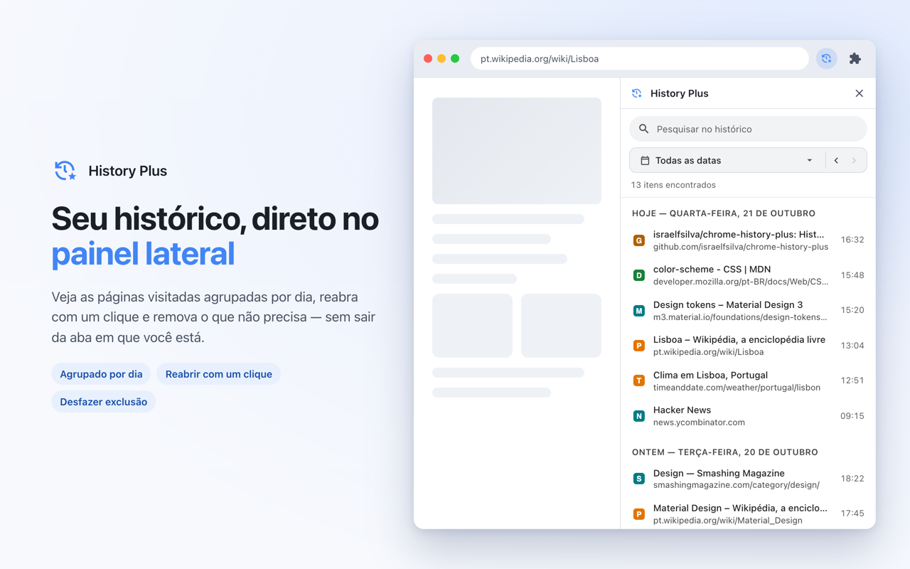
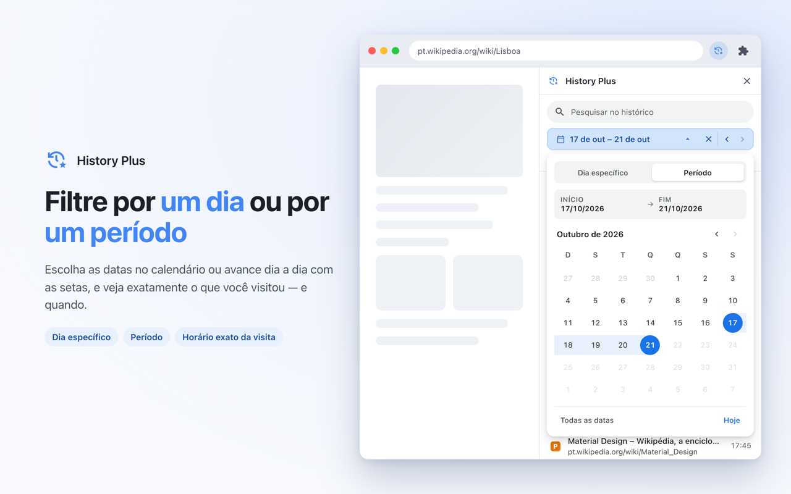
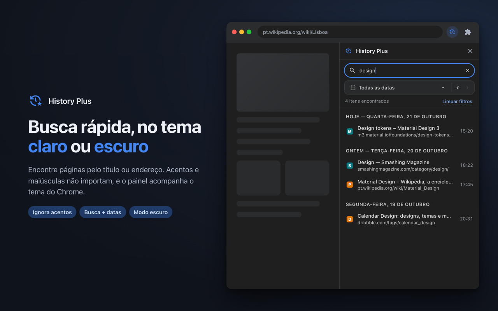

  

<h1 align="center">History Plus</h1>

  Seu histórico de navegação do Chrome no painel lateral, com busca e filtro por dia ou período. 
  <a href="README.md">Read in English</a>

## Recursos

- **Histórico no painel lateral**: veja as páginas visitadas agrupadas por dia sem sair da aba atual.
- **Filtro por dia ou período**: escolha um dia ou um intervalo de início e fim no calendário, ou avance dia a dia com as setas. A página de histórico nativa do Chrome não tem seletor de data.
- **Horário exato de cada visita**: a busca de histórico do Chrome só informa a última visita de cada URL. O History Plus resolve todas as visitas dentro das datas escolhidas, então uma página aparece em cada dia em que foi aberta, com o horário daquele dia.
- **Busca rápida**: encontra por título e endereço, ignorando acentos e maiúsculas, e funciona junto com o filtro de data.
- **Remover com desfazer**: apague uma página do histórico e desfaça em até 5 segundos.
- **Temas claro e escuro** que acompanham o Chrome, em português e inglês.

| Período | Busca no tema escuro |
| --- | --- |
|  |  |

## Instalação

- **Chrome Web Store**: em breve.
- **Pelo código-fonte**: clone este repositório, abra `chrome://extensions`, ative o **Modo do desenvolvedor**, clique em **Carregar sem compactação** e selecione a pasta do repositório. Clique no ícone do History Plus na barra de ferramentas para abrir o painel.

Requer o Chrome 116 ou mais recente.

## Permissões

| Permissão | Para que serve |
| --- | --- |
| `history` | Ler, pesquisar e remover itens do histórico de navegação. |
| `sidePanel` | Exibir a extensão no painel lateral do Chrome. |
| `favicon` | Mostrar o ícone de cada site a partir do cache local de favicons do Chrome. |

## Privacidade

O History Plus funciona inteiramente no seu dispositivo. Ele não faz requisições de rede, não tem analytics e não guarda nada fora do próprio histórico do Chrome. Veja a [política de privacidade](PRIVACY.md).

## Desenvolvimento

A estrutura de pastas e os comandos estão no [README em inglês](README.md#development). Em resumo:

- **Traduções**: os textos da interface ficam em `_locales/<idioma>/messages.json`. Os dois idiomas precisam ter as mesmas chaves, e o `tools/package.sh` confere isso.
- **Ícones**: `python3 tools/generate_icons.py` gera a pasta `icons/` na cor da marca `#4285F4`.
- **Imagens da loja**: `CHROME_BIN="/caminho/Google Chrome for Testing" tools/store-images/build.sh` gera os screenshots e os tiles promocionais nos dois idiomas, com um histórico de exemplo.
- **Pacote**: `tools/package.sh` valida o manifest e as traduções e gera `dist/history-plus-<versão>.zip`.

## Licença

[MIT](LICENSE) © 2026 Israel Silva
